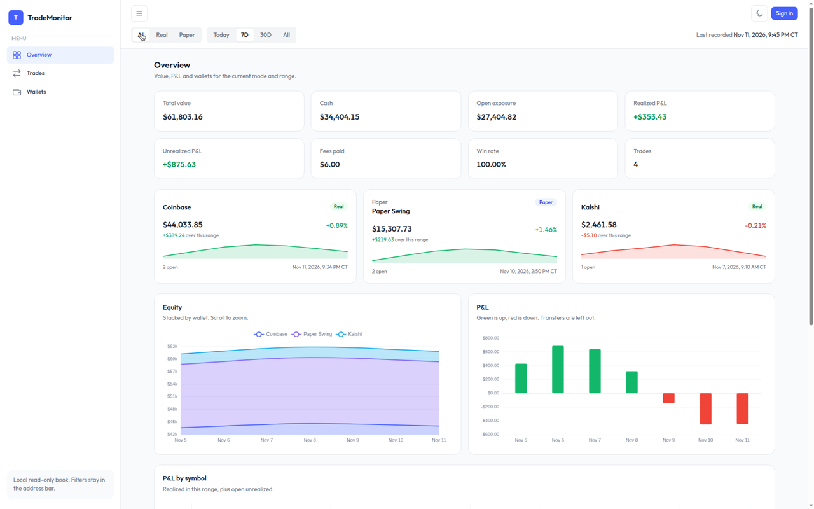
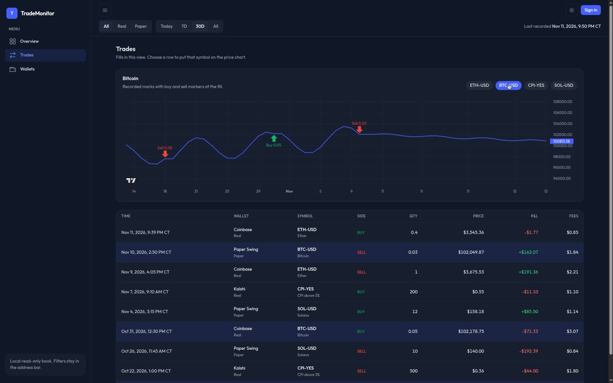
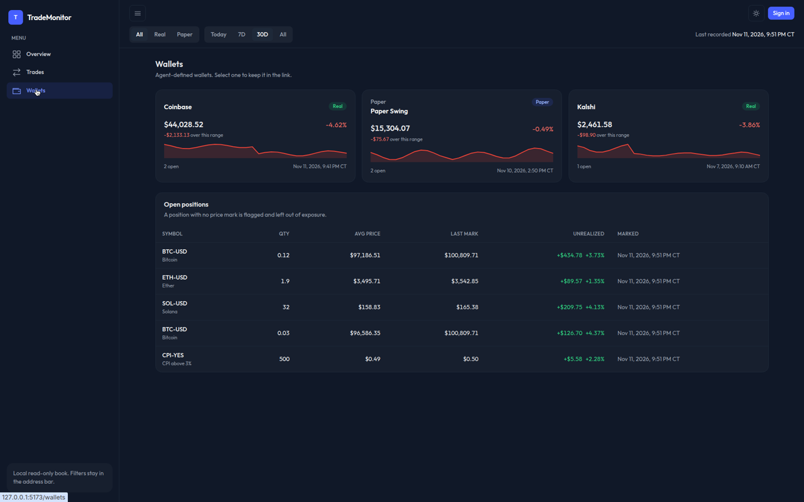
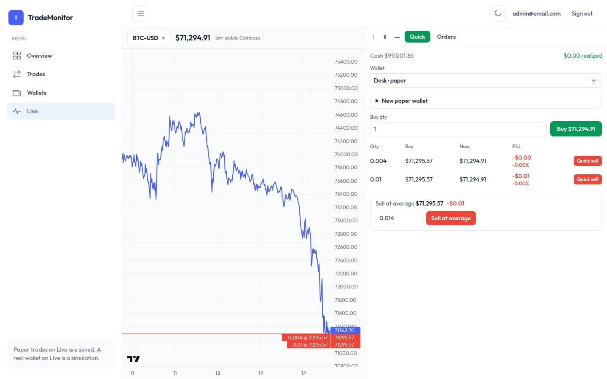
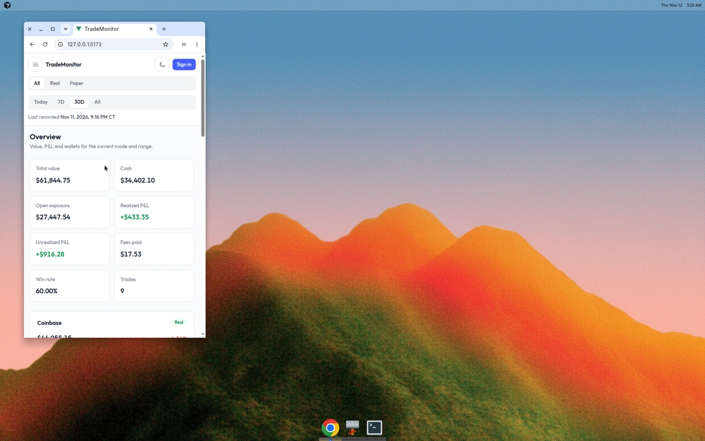

# TradeMonitor (Grokbot Daytrade Wallet)

A local dashboard to watch trading wallets, real and paper, with transaction history, buy price, current price, P&L and fees, plus an MCP server so a trading agent can record paper trades and read balances.

Status: template demo content has been removed. Feature work is tracked in the issues, in build order.

## Screenshots

Screenshots show sample data.



*Overview (light)*



*Trades price chart with buy/sell markers (dark)*



*Wallets and open positions (dark)*



*Live chart and trading panel (light)*



*Phone view*

## Wallets

| Wallet | Mode | How data gets in |
|---|---|---|
| Agent paper wallet | paper | Recorded by the trading agent through `/mcp` tools (trades, deposits, sweeps) |
| Coinbase | real | Read-only sync from the Coinbase Advanced Trade API (view-only key) |
| Kalshi | real, secondary | Read-only sync from the Kalshi API |

Coinbase and Kalshi stay read-only. The Live page can record paper trades into a paper wallet. It does not send orders to Coinbase.

## Stack

- .NET 10, ServiceStack 10, SQLite (OrmLite + EF Core Identity)
- Vue 3, Vite, TypeScript, Tailwind CSS 4, `@servicestack/vue`
- MCP: `ModelContextProtocol.AspNetCore`, served at `/mcp`, API key auth
- Charts: vue-echarts 8 with ECharts 6, TradingView lightweight-charts v5
- Layout: TailAdmin Vue (MIT), adapted into the client

## UI shell

Overview, Trades and Wallets share one read-only shell. The mode (All, Real, Paper), the date range (Today, 7D, 30D, All) and the selected wallet live in the URL query, so a view can be reloaded or shared. The page refreshes every 15 seconds. The shell reads wallets, trades, positions, and P&L from the ledger read API under `/api`. It does not record trades or move money.

Times are shown in America/Chicago with a CT label.

Layout, sidebar, header, card and table styles are adapted from [TailAdmin Vue](https://github.com/TailAdmin/vue-tailwind-admin-dashboard) (Vue 3, Tailwind CSS 4, TypeScript). TailAdmin Vue is MIT licensed, Copyright (c) 2026 TailAdmin.

Analytics charts use [vue-echarts](https://github.com/ecomfe/vue-echarts) 8 and [Apache ECharts](https://echarts.apache.org/) 6. Price charts use [TradingView Lightweight Charts](https://github.com/tradingview/lightweight-charts) v5, with buy and sell markers. Those libraries load only on the pages that draw them.

## Routes

The Vue app owns the site root. A fresh load or a shared link opens the app on the matching page:

- `/` overview, including `/?mode=paper&range=7d`
- `/trades` and `/trades?trade=<id>`, which opens that trade's drawer
- `/wallets`
- `/wallet/<key>`
- `/live` public Coinbase chart, paper orders, and an in-memory simulation for a real wallet

Ledger reads are JSON under `/api`:

| Read | Path |
|---|---|
| Summary | `GET /api/summary` |
| Equity | `GET /api/equity` |
| Daily P&L | `GET /api/pnl/daily` |
| P&L by symbol | `GET /api/pnl/symbols` |
| Fees | `GET /api/fees` |
| Positions | `GET /api/positions` |
| Trades | `GET /api/trades` and `GET /api/trades/{id}` |
| Wallets | `GET /api/wallets`, `GET /api/wallets/{key}`, `GET /api/wallets/{key}/balances`, `GET /api/wallets/{key}/history` |
| Price marks | `GET /api/price-marks` |

An `/api` path that is not a ledger read, a live route, or `/api/health` returns 404. It does not return the app. `/mcp` is unchanged.

## Live

`/live` shows a public Coinbase USD product. The chart fills the left side. The trading panel on the right folds to a thin rail, a normal column, or a wide panel, and the choice is kept in local storage. On a narrow screen the panel stacks under the chart.

Quick mode buys and sells at the public price in one click. Lots are listed with remaining quantity, buy price, the live price, and unrealized profit, most profitable first. Quick sell closes that lot. Sell at average sells the quantity you type against the average cost of what is still open. Both show the profit before the click.

Orders mode places market, limit, stop-loss, and take-profit orders. They stay open until they fill or you cancel them. Paper orders are stored in SQLite and fill from the public price while the app is running, even if the page is closed. A real wallet never receives those writes. Choosing one opens a simulation labeled "Simulation, not saved", with a reset button. Nothing from that simulation is stored.

Right-click the chart. A price level offers limit buy, limit sell, stop-loss, and take-profit at the cursor price. A lot line offers quick sell. An order line offers cancel and move. The time axis offers the candle size and zoom. Open orders and lot buy prices are drawn as horizontal lines.

Sells record how they were matched. FIFO, the existing rule, consumes the oldest lots. A lot sell consumes only that buy. An average sell takes the same fraction of every open lot, so the matched cost is the average. Realized profit from those fills shows on Overview, Trades, and Wallets. Live unrealized profit uses the public price. Overview unrealized profit still uses recorded price marks. The page does not write price marks.

Stop-limit orders are not in this version.

A later step can read a Coinbase key from `C:\DevCurrent\WalletSync\.env` on the owner's machine. This repository does not contain that file, and Live does not use a Coinbase key.

## Run locally

Requires the .NET 10 SDK and Node.js 24.

```bash
cd TradeMonitor.Client
npm ci

cd ../TradeMonitor
dotnet watch
```

`dotnet watch` starts the .NET host and the Vite dev server. The app listens on `https://127.0.0.1:5051` and `http://127.0.0.1:5050`.

Open `https://127.0.0.1:5051`. Sign in from the header. The first run creates the SQLite database and the local seed users shown on the sign-in page.

The trading agent writes through MCP at `http://127.0.0.1:5050/mcp`. Tool names, example calls, and API key setup are in [docs/mcp.md](docs/mcp.md). Copy `.env.example` to `.env` and set `MCP_API_KEY` there, or put the same value in gitignored `appsettings.Local.json`. Do not commit the key.

## Host PC (Windows)

From the repository root:

```powershell
powershell -NoProfile -ExecutionPolicy Bypass -File scripts\run.ps1
```

The script copies `.env.example` to `.env` when `.env` is missing, generates `MCP_API_KEY` when that value is empty, builds the client and the server in Release, and starts the app at `http://127.0.0.1:5050` with `ASPNETCORE_ENVIRONMENT=Production`. It refuses any URL that is not a loopback address. The full key stays in `.env` and is not printed.

`http://127.0.0.1:5050/api/health` reports database status, the last ledger write time, and the app version. That check stays on `/api/health`. Page links such as `http://127.0.0.1:5050/trades?trade=123` open the app. Ledger JSON for the same list is `http://127.0.0.1:5050/api/trades`.

Trading agent setup, example calls, backups, and the logon task are in [docs/agent-onboarding.md](docs/agent-onboarding.md).

## Checks

```bash
dotnet build TradeMonitor.slnx
dotnet test TradeMonitor.slnx

cd TradeMonitor.Client
npm ci
npm run test:run
npm run build
```

`.github/workflows/build.yml` runs those checks. `.github/workflows/gitleaks.yml` scans for secrets.

## Secrets

This repository is public. Never commit keys, `.env` files, `*.pem` files, databases or local appsettings.

- Keep API keys in `MCP_API_KEY`, `dotnet user-secrets` (project `TradeMonitor`), or a gitignored `appsettings.Local.json`. `.env.example` shows the variable names with empty values.
- `App_Data/` (the SQLite database) is gitignored.
- Every push and pull request runs a gitleaks secret scan (`.github/workflows/gitleaks.yml`, config in `.gitleaks.toml`).
- A future Coinbase read can use the key in `C:\DevCurrent\WalletSync\.env` on the owner's machine. Do not copy that file into this repository.

## Branches

- `main`: released state. Changes land only through reviewed merges from `staging`.
- `staging`: integration branch. One feature branch per issue, branched from `staging`, with a PR back into `staging` that includes its tests.
